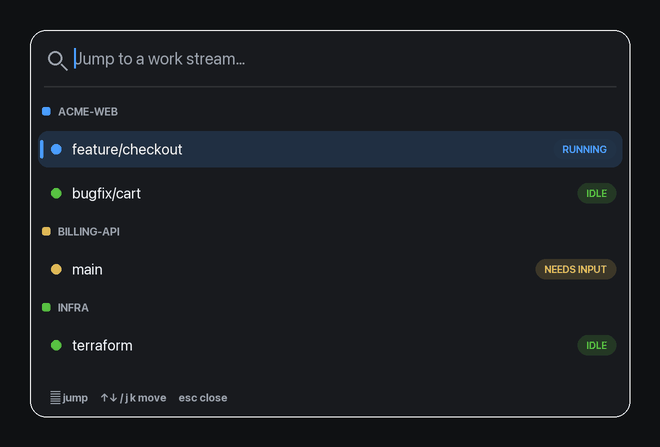

# WaveSwitcher

A **Ctrl+K work-stream switcher** for [Wave Terminal](https://waveterm.dev) on macOS.

Press `Ctrl+K` anywhere in Wave to pop up a fast, searchable palette of your tabs
grouped by workspace (project), each with a live status dot. Pick one and it jumps
straight to that workspace and tab — muscle memory borrowed from tools like
Spotlight, Raycast, and `agent-view`.



- **Search** — type to fuzzy-filter across projects and tabs.
- **Navigate** — `↑`/`↓`, `Ctrl+n`/`Ctrl+p`, or `j`/`k` (when the search box is empty). Wraps around top↔bottom.
- **Pin** — `Tab` pins/unpins the selected session; pinned ones float to a **PINNED** group at the top (persists per tab), so the sessions you're bouncing between stay one keypress away.
- **Follow-up** — `Ctrl+F` flags the selected session for follow-up, with an optional short note (type it right after flagging, `Enter` to save). Flagged rows get an amber flag marker and their note shown inline, so an idle session you need to circle back to stays easy to spot. Jumping to a flagged session clears its flag; `Ctrl+F` again also clears it.
- **Jump** — `Enter`. **Dismiss** — `Esc` or click outside.
- **Usage** — the footer shows your Claude subscription usage (5-hour **session** % and 7-day **week** %), colored as it climbs, so you can see how close you are to your limits without leaving the picker.
- **Live status** — each tab shows `running` / `subagents` / `shell` /
  `compacting` / `needs input` / `idle` from its Wave flag color. `shell` means the session
  finished its turn but a background task it launched is still running, so it's
  not actually free (see [Live status](#live-status-optional)).

## Requirements

- **macOS**
- **[Wave Terminal](https://waveterm.dev)**
- **[Hammerspoon](https://www.hammerspoon.org)** — the automation runtime this plugs into
  (`brew install --cask hammerspoon`)
- `sqlite3` — already built into macOS (no `jq` or other dependencies)

## Install

One line:

```sh
curl -fsSL https://raw.githubusercontent.com/doyled-it/wave-switcher/main/install.sh | sh
```

Or clone and run the installer:

```sh
git clone https://github.com/doyled-it/wave-switcher.git
cd wave-switcher
./install.sh
```

The installer copies the Spoon into `~/.hammerspoon/Spoons/`, adds three lines to
your `~/.hammerspoon/init.lua`, and reloads Hammerspoon. It won't touch anything
if Hammerspoon isn't installed (`brew install --cask hammerspoon`).

Then, **once**:

1. Grant Hammerspoon Accessibility permission (needed to send keystrokes):
   **System Settings → Privacy & Security → Accessibility → enable Hammerspoon**.
2. Focus Wave Terminal and press **`Ctrl+K`**.

### Manual install

Copy `WaveSwitcher.spoon` into `~/.hammerspoon/Spoons/`, then add to `~/.hammerspoon/init.lua`:

```lua
hs.loadSpoon("WaveSwitcher")
spoon.WaveSwitcher:bindHotkeys({ open = {{"ctrl"}, "k"} })
spoon.WaveSwitcher:start()
```

Reload Hammerspoon (menu-bar icon → *Reload Config*).

## Configuration

Change the hotkey by editing the `bindHotkeys` line, e.g. `Cmd+K`:

```lua
spoon.WaveSwitcher:bindHotkeys({ open = {{"cmd"}, "k"} })
```

**Theme** — the picker matches your Wave terminal theme automatically. If you've
set a theme in Wave (`term:theme` in `~/.config/waveterm/settings.json`), the
popup adopts its background, text, and accent colors; otherwise it uses its
built-in dark palette. Status dot colors stay the same regardless. (Matching
covers Wave's common built-in themes; others fall back to the default palette.)

## Claude Code integration

If you run [Claude Code](https://claude.com/claude-code) in Wave, the installer
also wires up two extras (skip with `./install.sh --no-claude`). Both are driven
by one hook script, `wave-claude-hook.sh`, added to `~/.claude/settings.json`
(existing hooks are preserved; re-running is idempotent):

**Live status dots** — each tab's status flag is kept in sync so the picker shows it:

| State | Flag color | Picker |
|-------|-----------|--------|
| session start / done | `#58c142` | 🟢 idle |
| working (prompt submitted / tool finished) | `#4a9eff` | 🔵 running |
| subagents running (`Agent`/`Task` tool, e.g. subagent-driven dev) | `#a970ff` | 🟣 subagents |
| idle, but a background task it launched is still running | `#20c4b0` | teal "shell" |
| compacting context (`PreCompact`) | `#e86f9e` | rose "compacting" |
| needs input (permission / question) | `#e0b956` | 🟡 needs input |

**Clickable notifications** — when a session needs you, a notification names the
**workspace › tab** and **jumps to that tab when you click it** (posted via
Hammerspoon so the click can switch tabs; falls back to a plain notification if
the `hs` CLI isn't available).

**Resume after a Wave restart** — when Wave restarts, its terminal tabs come back
as fresh shells (the running `claude` process is gone). The hook records each
session's id on its tab (in Wave metadata, which survives a restart) and clears it
on a clean exit. A snippet added to `~/.zshrc` then checks, on a fresh interactive
shell in a Wave tab, whether that tab had a session — and if so runs
`claude --resume <id>` to bring it back. It fires only after an unexpected restart,
consumes the marker so it can't loop, and never runs in bare-terminal tabs or
inside Claude's own tool shells.

Requires Wave's `wsh` CLI (installed with Wave) on your `PATH`, and `python3`
(built into macOS) for the settings merge.

## Usage indicator

The footer shows your Claude **subscription** usage — the same 5-hour session and
7-day weekly percentages as Claude Code's `/usage` panel. It's read from the
undocumented OAuth usage endpoint (`GET https://api.anthropic.com/api/oauth/usage`),
authenticated with the token already in your macOS Keychain
(`Claude Code-credentials`). The token is read locally and sent **only** to
`api.anthropic.com`; results are cached 60s (`wave-usage.sh`). Since the endpoint
is unofficial it may change or disappear — if it does, the line just goes blank
and nothing else breaks.

## How it works

- **Listing** — `wave-sessions.sh` reads Wave's own SQLite state DB
  (`~/Library/Application Support/waveterm/db/waveterm.db`) **read-only** and emits
  the workspaces and their tabs as JSON. Pure `sqlite3`; nothing is written.
- **Jumping** — the target **workspace is selected by name** through Wave's
  *Workspace* application menu (robust, and not limited to 9), then the **tab is
  selected with Wave's native `Cmd+<n>`** shortcut.
- **Focus** — the popup is a render-only `hs.webview` that never takes keyboard
  focus, so Wave stays the key window (required for `Cmd+<n>` to register). Input
  is handled by a Hammerspoon event-tap.

## Limitations

- macOS only (it drives Wave's macOS app menu and native shortcuts).
- Tab switching uses `Cmd+1..9`, so the 10th+ tab in a single workspace isn't
  directly reachable. Workspaces have no such limit (selected by name).
- Status reflects Wave flag colors; without a workflow that sets them, tabs show `—`.

## Uninstall

```sh
rm -rf ~/.hammerspoon/Spoons/WaveSwitcher.spoon
```

Then:
- remove the three `WaveSwitcher` lines from `~/.hammerspoon/init.lua` and reload Hammerspoon;
- if you enabled the Claude integration, remove the `wave-claude-hook.sh` entries
  from `~/.claude/settings.json` (a timestamped `.bak` was saved next to it) and
  delete the `# WaveSwitcher resume` block at the end of `~/.zshrc`.

## License

[MIT](LICENSE)
